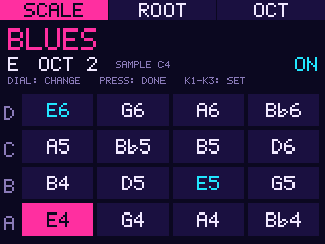

# MPC Sample Scale Mode

An addin for the MPC Sample: **hold 16 Levels** to play its 16 slots in a scale,
with a **SCALE page** on the screen to pick the scale, root and octave.

On the Sample, 16 Levels spreads one sound over 16 slots (4 pads x 4 banks) and
Shift+16 Levels cycles its Type (Tune, Velocity, Filter). With Scale on, the slots
play the notes of a scale instead of those steps.



## Use

1. Put a melodic sample on a pad and press **16 Levels** to turn it on.
2. **Hold 16 Levels** for about a second: Scale turns on and the SCALE page opens.
   Hold it again to turn Scale off. A short press is still a normal 16 Levels press,
   and Shift+16 Levels still cycles the Type.
3. Play the pads; switch banks for the higher notes. The page lights the slot you
   play and shows every slot's note, the root's notes in cyan.

On the page: the three soft keys pick **SCALE**, **ROOT** or **OCT**, the dial
changes it, K1-K3 set the three directly, and pressing the dial closes the page
(holding 16 Levels twice, Scale off and on, brings it back). The page stays
up for as long as Scale is on; after the hold that turns Scale off it gives the
screen back to MPC a few seconds later. Changes are saved to the settings file and survive a restart; Scale
itself starts off each time MPC starts.

Recording works as with 16 Levels: hits recorded into a sequence (Overdub while it
plays) keep their scale notes, stored as each event's coarse tuning, and play back at
those pitches with Scale off too (checked on an MPC Sample, firmware 1.3.0.12, 2026-11-06).

The page needs the [MPC Sample draw handler](https://github.com/jacob-sabella/mpc-addin-sample-draw-handler)
addin (1.0.1 or later). Without it, holding 16 Levels still toggles Scale.

## Scales

8 built-in scales: Chromatic, Major, Minor, Harmonic Minor, Dorian, Blues,
Phrygian, Mixolydian. Default: Blues, root C3, so bank A plays C3, Eb3, F3, F#3.

## Install

From a release zip: copy it to the device and run `install.sh`. From source:

```sh
make build         # cross-compile for aarch64 (needs Docker)
make release       # package the dist zip
make deploy MPC_HOST=root@<device-ip>
```

Before 0.3.0 this addin was called Enable Scale Mode (`mpc-addin-enable-scalemode`,
folder `/data/mpc-addins/enable-scalemode`). If you installed it, uninstall it first:
`sh /data/mpc-addins/enable-scalemode/uninstall.sh`. While the old one is still loaded,
this one stays off and says so in MPC's log.

## Settings

`mpc_sample_scalemode.conf` next to the `.so`:

```
enabled=1          # 0 to load but do nothing
scale=Blues        # Chromatic, Major, Minor, Harm Minor, Dorian, Blues, Phrygian, Mixolydian
root=C3            # note name with octave, or MIDI number (0-127)
octave_offset=2    # -4 to 4; 2 puts bank A's first pad on the root
hold_ms=800        # how long a hold of 16 Levels toggles Scale (at least 200)
page=1             # 0: no SCALE page
padperform_patch=0 # 1 forces the PadPerform bool (blocks 16 Levels)
pad_root=60        # only when MPC's root note for the sample can't be read (see below)
detect_pitch=1     # 0: take MPC's 60 as is, don't listen for the note of an untagged sample
```

**The sample's own note.** Scale reads the root note MPC keeps for the sample
16 Levels plays (from the WAV's `smpl` chunk when it has one, else 60 = C, and
editable in MPC) and moves the sample from that note to the scale, by note name:
slot 0 stays within half an octave of the sample's own pitch, and `octave_offset`
moves everything by octaves. The page shows it as SAMPLE. A sample tagged with
the wrong note plays the scale that far off, as it would in a keygroup: one Moog
lead here sounds C# but its file says D. When the note can't be read (other
firmware), `pad_root` stands in.

**Untagged samples are listened to.** A WAV with no note in it gets MPC's
default, 60, and so the addin checks every 60 by ear: in the background it reads
the sample's audio (from memory, or from its WAV file when MPC streams it from
disk), finds its pitch, and uses that note instead. The page then shows
SAMPLE <note> BY EAR. A sample with no clear pitch (most drums, noise, dense
chords) keeps 60, and a drum with a tuned tail, like an 808 kick, gets the
tail's note. The first hit of a new sample still plays from 60; the
detection takes tens of milliseconds, and every hit after it uses the note
heard. `padctl hear` shows what the addin hears in the last sample played.

The page and `padctl` rewrite `scale`, `root` and `octave_offset` in place and
keep the rest of the file.

## padctl

```sh
padctl status          # Type, Scale on/off, scale, root, hook state
padctl scale Blues     # change scale (prefix match, case-insensitive)
padctl root A2         # change root note
padctl octave -1       # octave offset
padctl page            # open the SCALE page
padctl testmap 0       # dry run: what pad 0 would play
padctl hear            # the pitch heard in the last sample played, beside MPC's root note
padctl hookhits        # how many times the note hook has fired
padctl note <ch> <note> [vel] [hold ms]   # inject a control-surface press (testing)
padctl on|off <ch> <note> [vel]           # one half of a press, for combinations
padctl lat scale|page <hits> <period ms>  # slot 0 on an exact grid, Scale or the page flipped every other hit (latency test)
```

## Testing

- `tests/hold_test.c`: host test of the 16 Levels hold filter (`gcc -fsanitize=address,undefined`).
- `tests/pitch_detect_test.c`: host test of the pitch detection on made-up sounds (pitched ones from E1 to C7,
  noise and a snare that have none), plus any WAV files given with the note they should read:
  `cc -O2 -o /tmp/pdt tests/pitch_detect_test.c -lm && /tmp/pdt lead.wav=61 hat.wav=none`.
- `tests/device_test.sh`: the whole sequence on a Sample over SSH, no hands on the
  device. Button and pad presses go in with `padctl note/on/off`, the screen comes
  back through the draw handler's `/snap`, and the page frames come out as a GIF.
  `RESTART=1` also checks that a page change survives an MPC restart. With `AUDIO_SRC` (the
  Sample's USB audio on the computer) it checks every slot's pitch and that the page and Scale
  add no delay to a pad (`padctl lat`, `tests/latency_check.py`): on 2026-11-06 the page, which
  then refreshed the whole screen 16 times a second, made pads up to 80 ms late (18 ms on average); it now
  sends only what changed, and neither adds a measurable delay.

  ```sh
  MPC_HOST=root@<device> SSH_KEY=~/.ssh/<key> RESTART=1 tests/device_test.sh
  ```

## Known limitations

- **Pads need samples.** The firmware skips the note mapping for pads with no
  sample, so Scale repitches the sample already on the pad.
- **Reinstall after a reboot.** On the Sample the shared installer puts the
  `LD_PRELOAD` drop-in on `/run`, which is tmpfs; the installer says so.
- **A tagged note is trusted.** Only MPC's 60 (untagged, or tagged 60) is checked by
  ear; any other note is used as MPC has it, even when the file's tag is wrong.
- **By ear, WAV files only from disk.** A sample MPC streams from a file that isn't a
  WAV (16, 24 or 32-bit PCM, or 32-bit float) keeps 60. Short samples and recordings,
  which MPC holds in memory, are read there whatever their file.
- **Type names not mapped.** `padctl status` prints the native Type as a number (0-2).

## How it works

1. The `.so` is loaded via `LD_PRELOAD` (standard addin mechanism).
2. It wraps `read`, `poll` and `ppoll` on the control-surface port: a 16 Levels
   press is held back until it is released (passed on as a normal press) or held
   past `hold_ms` (Scale toggles, MPC sees nothing). With Shift down it passes
   straight through. The draw handler wraps the same calls; the two chain.
3. It hooks the note mapping function with a PACIASP trampoline that, while Scale
   is on, repitches each slot through the scale tables via the note setter, from
   the sample's root note (16 Levels pad -> program -> instrument -> layer ->
   sample, each pointer read through `/proc/self/mem`, so a wrong one fails
   instead of crashing MPC).
4. For a sample at 60, a worker thread reads its audio (the sample's audio object
   is a `MemorySample` or a `DiskSample`, told apart by its RTTI; the second is read
   from its file), runs YIN on a few windows past the attack (`src/pitch_detect.h`),
   and keeps the result per sample.
5. The SCALE page is a draw handler client: it takes the screen when Scale
   toggles and gives it back when idle.
6. A socket server on `/tmp/padmode.sock` accepts `padctl` commands.

## Credits

Scale playing on the MPC Sample was first done by
[SampQOL OS](https://github.com/snarebes/SampQOL-OS), the free SD-card mod for the
MPC Sample by [snarebes](https://github.com/snarebes). This addin is built on that work:

- **Where to hook.** The firmware functions it hooks are the ones SampQOL OS uses for its
  Scale feature: the note mapping MPC runs for each 16 Levels slot, the 16 Levels Type
  cycle and the 16 Levels button.
- **How a slot becomes a note.** Its slot-to-note math follows SampQOL OS: the scale's
  interval for the slot, whole octaves for the slots past the first octave plus the octave
  offset, the root moved by at most half an octave, a -24 base, clamped to ±120, and the
  same field in the pad's note event cleared before the note is set.

SampQOL OS is closed-source freeware that runs from an SD card. This
addin is a separate implementation of the idea as an addin that loads with the stock
firmware. What it adds: the hold gesture, the SCALE page (through the draw handler),
starting from the sample's own root note, and pitch detection for untagged samples.
The two hook the same functions and haven't been tested together: use one or the other.

## License

MIT
